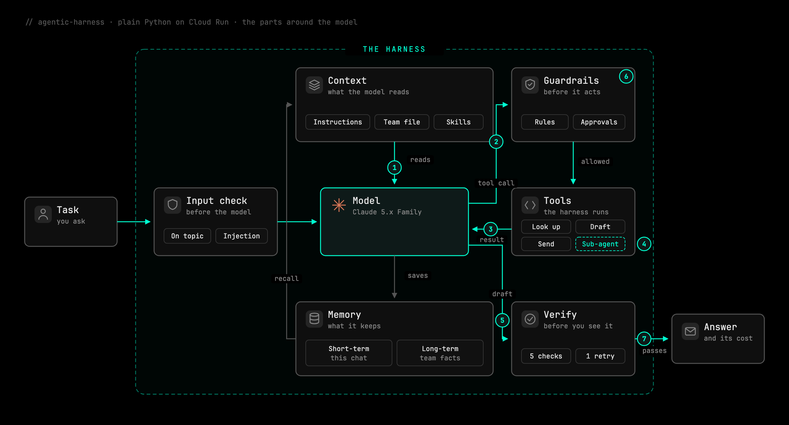

<!--
Keeping this file current:
- Keep it project-level and short. Per-check progress lives in Tracker.md.
- Every claim here must be true of the code today; config examples use real keys.
-->

<div align="center">

# agentic-harness

**An AI agent harness, built from scratch in plain Python.**<br>
No agent framework. Every line is readable, tested and explained.

[](https://github.com/gauravlahoti/agentic-harness/actions/workflows/ci.yml)


### [▶ Watch the guided tour](https://agentic-harness.gauravlahoti.dev/)

Five minutes, voiced, replaying a real recorded run. No sign-up, no key.

</div>

---

## The idea

> **Agent = Model + Harness.**

A model on its own is a brain in a jar: it can tell you how to send a proposal, but it can't send it. The **harness** is everything around the model that lets it do real work, safely:

- **Loop:** call the model, run the tools it asks for, repeat, and know when to stop.
- **Context and memory:** decide what goes into the model's window, and what lasts beyond it.
- **Tools:** the model only *asks*; the harness runs the tool and returns the result.
- **Guardrails:** who may do what, lines that are never crossed, and when a person must approve.

The model picks the next step. The harness does everything else.

## How a run works



Every step is saved as a trace. The page draws the run live, and the same trace replays as the [guided tour](https://agentic-harness.gauravlahoti.dev/).

## The first agent: CloudCo's Contract Agent

CloudCo sells software. Two days before quarter end, its customer ShopCo sends back a $480,000 renewal with about 60 edits, and five of them matter: a 25% discount, Net 60 payment, 99.99% uptime, unlimited liability and a three-year price lock. The agent finds the changes that matter, checks each against CloudCo's terms, says who must approve, and drafts the reply. **People decide; the agent never agrees on its own.**

*CloudCo, ShopCo, the people and every number are made up.*

| Harness part | What it handles | In the CloudCo run |
|---|---|---|
| **Loop** | Plan → act → observe → repeat; stops at a step, cost or time limit | Keeps a to-do list and can't finish with items open |
| **Context** | Standing instructions, team files, skills loaded only when needed | Loads the contract-review skill when the task needs it |
| **Memory** | Facts that last across conversations; old turns pruned or summarised when the window fills | Starts knowing what was agreed last time |
| **Tools** | Workspace tools, built-in tools, helper agents with their own budget | A clause-reviewer reads the 40-page markup; the main agent gets 5 lines |
| **Guardrails** | Tools and fields per team, hard limits, approval chains | 25% discount needs the CFO, and the server checks who is answering |
| **Verification** | Code checks the draft before you see it; a failure goes back once | A draft that missed two changes is sent back and fixed |

## Three layers check every answer

| Layer | When | Blocks the answer? | How |
|---|---|---|---|
| **Verification** | Before you see it | Yes, one retry | Plain code: plan complete, every change covered, right approver, email matches the agreed terms |
| **Online evals** | After every live answer | No | One small judge call: groundedness, relevance, hallucination, citations, style |
| **Offline evals** | On demand: `make eval` | No | A golden dataset, the same scorer, several runs per case |

## Quick start

You need [uv](https://docs.astral.sh/uv/).

```bash
git clone https://github.com/gauravlahoti/agentic-harness && cd agentic-harness
make setup                      # install the locked dependencies
make check                      # lint, strict types, offline tests: free, no key
cp .env.example .env            # add your Gemini key: https://aistudio.google.com/apikey
uv run agentic-harness serve --workspace workspaces/cloudco
```

Open **http://127.0.0.1:8000**, pick a team and give the agent a task. The **Harness** pane on the right shows each part as it works; **Observability** holds the online and offline evals.

> **Using a coding agent?** Open the repo in Claude Code, Codex or Antigravity and ask it to set up and check the project. It follows [CLAUDE.md](CLAUDE.md) ([AGENTS.md](AGENTS.md) for the others). Add the key to `.env` yourself: agents are told never to read it.

## Build your own agent

**An agent is a folder.** Point the same harness at another folder and you have another agent, with no harness code changed. A test keeps the harness free of any domain word.

```text
workspaces/<name>/
├── workspace.toml     # wiring the model never sees: memory, skills, teams, limits, approvals
├── AGENTS.md          # standing instructions
├── teams/<team>.md    # what each team needs to know
├── skills/<team>/     # SKILL.md folders, loaded on demand
└── tools.py           # the agent's own tools
```

```toml
memory = ["AGENTS.md", "teams/{profile}.md"]
skills = ["skills/{profile}"]

[profiles.engineering]
tools       = ["read_contract", "search_policy"]
hide_fields = ["annual_value_usd"]          # Engineering never sees prices

[[rules]]                                   # a line the company never crosses
id    = "discount-never"
tool  = "send_to_customer"
arg   = "discount_pct"
above = 25

[[approvals]]                               # a person signs off first
tool     = "send_to_customer"
approver = "Finance"
arg      = "payment_days"
above    = 45
```

The smallest agent, [`workspaces/hello`](workspaces/hello), is one tool and three lines of config.

## Safe by default

- **Local only.** The server answers on `127.0.0.1`.
- **One home for the key.** Only `config.py` reads it, and it never reaches logs, traces or the page.
- **No real side effects.** "Sent" emails land in a local outbox.
- **Read-only when hosted.** The public tour (`HARNESS_PUBLIC=1`) answers reads only and holds no key.
- **Guarded repo.** Secret scanning and a pre-commit leak check on every commit.

More in [Security](Security.md). `make help` lists every command.

## Under the hood

- **Gemini** through the Interactions API, with the harness running every tool itself: no automatic function calling, no server-side tools. **Claude** (Haiku or Sonnet) is an optional, paid choice per run.
- **Built in stages**, tests first. Each choice is recorded with its options, reasons and cost in [Decisions](Decisions.md); progress is in [Tracker](Tracker.md); stage walkthroughs are in [docs/](docs).
- **Quality bar:** ruff, strict mypy and 590+ offline tests on every change. Real-model tests run only on request (`make live`).

| Read next | |
|---|---|
| [Product](spec/00-product.md) | What it is and why |
| [Company](spec/01-company.md) | CloudCo's made-up world |
| [How we build](spec/how-we-build.md) | Stages, checks and the review loop |
| [Decisions](Decisions.md) | Every real choice and its cost |

## Author

Built by **[Gaurav Lahoti](https://gauravlahoti.dev)**, as a hands-on way to learn what makes an AI agent work, one harness part at a time.

[gauravlahoti.dev](https://gauravlahoti.dev) · [Guided tour](https://agentic-harness.gauravlahoti.dev/)

## License

[MIT](License.md). Use it, change it, build on it; just keep the copyright notice.
